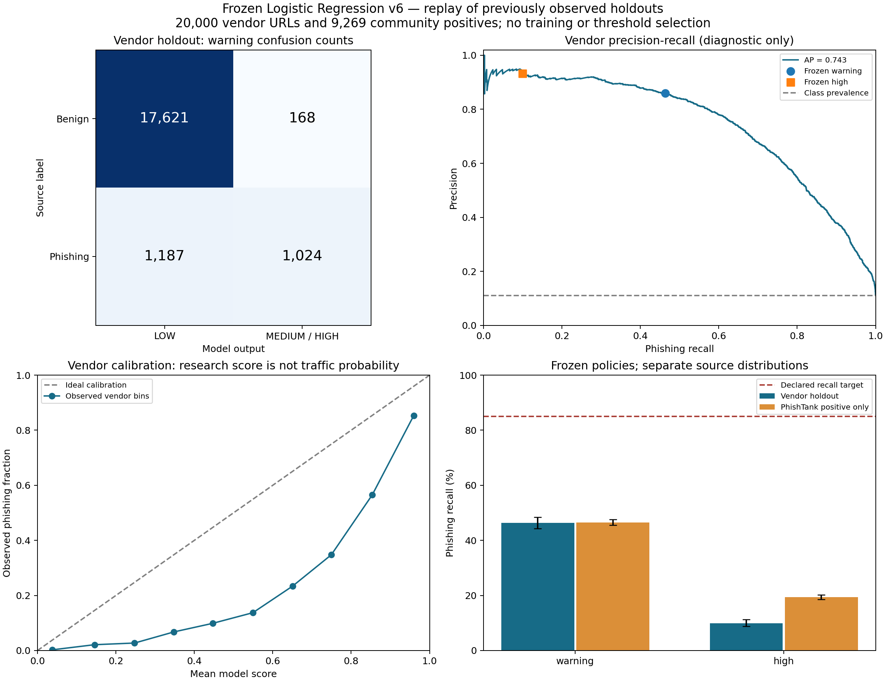

# Pengujian Kualitas Frozen v6

Kesimpulan: v6 belum cukup andal sebagai satu-satunya pendeteksi phishing untuk penggunaan publik. Implementasi berjalan konsisten, tetapi recall masih rendah dan release gate belum terpenuhi.

Pengujian ini memprediksi ulang 29.269 URL yang sebelumnya sudah teramati: 20.000 URL vendor dua kelas dan 9.269 phishing komunitas. Ini bukan holdout independen baru. Binary, metadata dan threshold asli tetap sama; tidak ada training, relabel, pemilihan threshold atau pengambilan URL baru.

| Pengujian | Accuracy | Precision | Recall phishing | FPR |
| --- | ---: | ---: | ---: | ---: |
| Vendor, warning MEDIUM+HIGH | 93.23% | 85.91% | 46.31% | 0.944% |
| Vendor, HIGH saja | 89.96% | 93.22% | 9.95% | 0.090% |
| PhishTank, warning | Tidak tersedia | Tidak tersedia | 46.53% | Tidak tersedia |
| PhishTank, HIGH | Tidak tersedia | Tidak tersedia | 19.35% | Tidak tersedia |

## Arti hasil

Pada vendor, 1,024 dari 2,211 phishing tertangkap; 1,187 terlewat. Dari 17,789 benign, 168 salah mendapat warning. Pada PhishTank, 4,313 tertangkap dan 4,956 terlewat. Distribusi feed positif dan benign historis berbeda; jangan menggabungkannya sebagai accuracy atau precision trafik.

Accuracy vendor 93.23% perlu dibaca bersama balanced accuracy 72.68%. Referensi konstan yang selalu menyebut benign mendapat accuracy 88.94% namun recall nol; ini hanya pembanding ketimpangan kelas, bukan model alternatif.

Wilson 95% recall vendor sekitar [44.24%; 48.40%]. Wilson FPR sekitar [0.812%; 1.098%], sehingga bukti belum mendukung jaminan FPR di bawah 1%. Bootstrap domain 1.000 kali dan semua interval tersimpan dalam JSON. Interval tidak menghapus ketidakpastian label atau campaign overlap.

ROC-AUC vendor 0.9404, AP 0.7432, Brier 0.09024. Mean model score 0.2651 dibanding fraksi phishing berlabel sumber 0.1105; skor riset tidak otomatis menjadi probabilitas trafik. Tidak ada kalibrasi ulang pada holdout.

## Implementasi dan runtime

Tes Python: 70 lulus tanpa failure/error/skip. Checksum, domain/digest separation, 62 referensi sintetis dan prediksi URL/QR cocok. Input unsupported tanpa skor/band dan respons tidak menggemakan target. Gap redaksi path pendek tetap direproduksi dengan input sintetis; parser beku tidak diubah.

Probe warm 128 request berurutan pada satu proses lokal: p50 6.11 ms, p95 8.28 ms. Termasuk parser, fitur, classifier, kalibrator dan respons shadow; tidak mencakup HTTP/jaringan/cold start atau beban deployment.

## Penggunaan yang didukung bukti

Gunakan untuk prototipe atau riset/internal shadow dengan verifikasi lanjutan. Gold Indonesia dan benign kontemporer belum tersedia, sebagian label masih memerlukan review, dan target lower-bound recall 85% belum tercapai. LOW bukan SAFE. Memakai hanya HIGH menurunkan cakupan deteksi lebih jauh.

Laporan angka: [v6-quality-evaluation.json](v6-quality-evaluation.json). Protokol sebelum scoring: [v6-quality-protocol.json](v6-quality-protocol.json). Replay ini tidak mengubah bobot/threshold atau status produksi.

